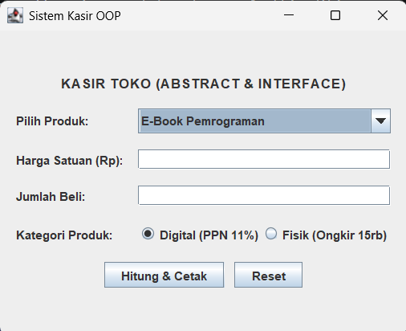

# 🛒 Point of Sale System (Java Swing & OOP)

> Aplikasi Desktop Sistem Kasir & Perhitungan Transaksi berbasis **Java Swing** dengan penerapan **Object-Oriented Programming (OOP)** (*Interface, Abstract Class, Encapsulation, Inheritance,* dan *Polymorphism*).


---

## 👤 Identitas Penyusun

| Keterangan | Detail |
| :--- | :--- |
| **Nama** | Suci Mustika Ramadhani |
| **NIM** | F1D02510093 |
| **Kelas** | B |


---

## ✨ Fitur Utama

* **Perhitungan Transaksi & Struk Digital** — Memproses perhitungan harga (`Hitung & Cetak`) dan mengosongkan formulir input (`Reset`) secara instan.
* **Kalkulasi Biaya Tambahan Otomatis** — Biaya tambahan dan total akhir dihitung secara dinamis sesuai kategori produk yang dipilih:

| Kategori Produk | Biaya Tambahan | Rumus Total Bayar |
| :--- | :---: | :--- |
| **Digital** (`ProdukDigital`) | PPN `11%` | `(Harga * Jumlah) + (Harga * Jumlah * 0.11)` |
| **Fisik** (`ProdukFisik`) | Ongkir `Rp 15.000` | `(Harga * Jumlah) + 15000` |

* **Validasi & Keamanan Input** — Menangani kesalahan input non-angka (`NumberFormatException`) menggunakan dialog peringatan agar aplikasi tidak *crash*.
* **Ringkasan Struk Interaktif** — Menampilkan rincian transaksi lengkap (nama item, harga satuan, jumlah beli, biaya tambahan, dan total akhir) dalam jendela *pop-up*.

---

## 🖼️ Tampilan Aplikasi



---

## 🧩 Arsitektur & Penerapan OOP

| Komponen / Kelas | Peran dalam Program | Konsep OOP yang Diterapkan |
| :--- | :--- | :--- |
| `Pembayaran` | Kontrak method `hitungTotal()` dan `cetakStruk()` | **Interface** |
| `Produk` | Menyimpan atribut dasar (`namaProduk`, `hargaDasar`, `jumlah`) & method abstrak `getBiayaTambahan()` | **Abstract Class & Encapsulation** |
| `ProdukDigital` | Implementasi perhitungan PPN `11%` & format struk produk digital | **Inheritance & Polymorphism** |
| `ProdukFisik` | Implementasi perhitungan ongkos kirim flat `Rp 15.000` & format struk produk fisik | **Inheritance & Polymorphism** |
| `Main` | Window utama, tata letak GUI Swing, dan *event listener* tombol | **GUI Composition & Event Handling** |

---

## 🖥️ Komponen GUI yang Digunakan

Antarmuka disusun menggunakan **Java Swing** dengan tata letak `GridBagLayout` dan `FlowLayout`, melibatkan komponen utama berikut:

1. **`JFrame` (`Main`)** — Jendela utama aplikasi berukuran `420x340` yang diposisikan di tengah layar (`setLocationRelativeTo(null)`) dengan `EXIT_ON_CLOSE`.
2. **`JLabel`** — Menampilkan header judul `KASIR TOKO (ABSTRACT & INTERFACE)` serta label keterangan untuk setiap kolom input (`Pilih Produk`, `Harga Satuan`, `Jumlah Beli`, `Kategori Produk`).
3. **`JComboBox<String>`** — Menu *dropdown* untuk memilih produk (`Lisensi Software`, `E-Book Pemrograman`, `Keyboard Mechanical`, `Mouse Wireless`).
4. **`JTextField`** — Kolom input teks satu baris untuk mengisi nominal **Harga Satuan** dan **Jumlah Beli**.
5. **`JRadioButton` & `ButtonGroup`** — Pilihan kategori transaksi (`Digital` atau `Fisik`) yang saling eksklusif (hanya bisa dipilih salah satu).
6. **`JButton`** — Dua tombol aksi (`Hitung & Cetak` dan `Reset`) yang memicu logika transaksi melalui `ActionListener`.
7. **`JOptionPane`** — Dialog *pop-up* untuk menampilkan rincian struk pembayaran maupun pesan error ketika input tidak valid.

---

## 🚀 Cara Menjalankan

> **Prasyarat:** Pastikan **JDK** sudah terinstal dan perintah `javac` serta `java` dapat diakses melalui terminal/CMD.

1. Simpan kode sumber ke dalam berkas bernama `Main.java`.
2. Kompilasi program:
   ```bash
   javac Main.java